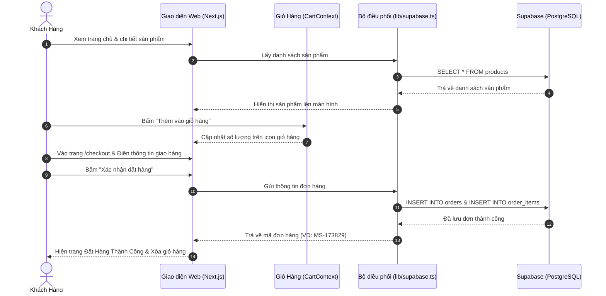
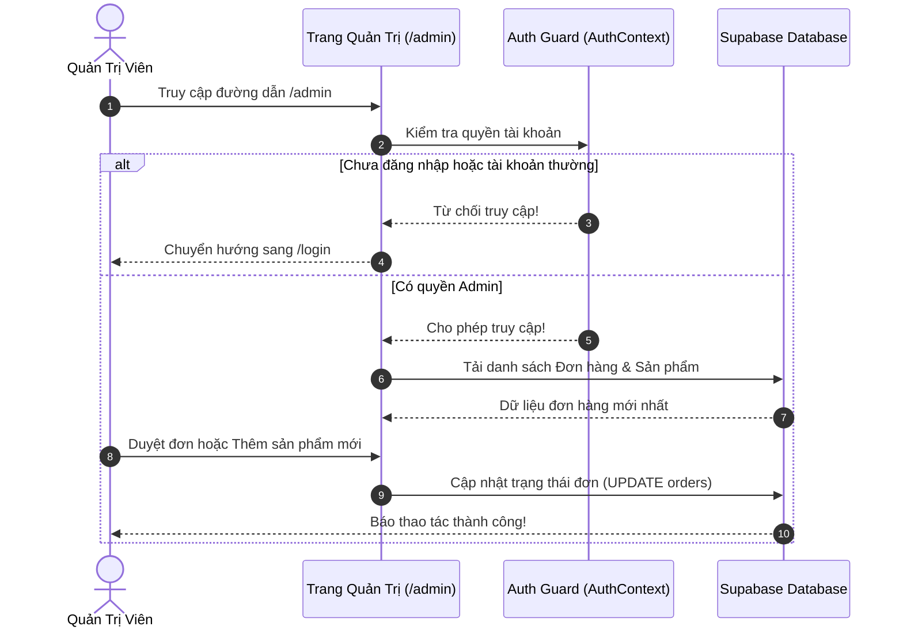

# 📘 GIÁO TRÌNH HƯỚNG DẪN DỰ ÁN MINI SHOP DECOR
## TỪ KIẾN TRÚC HỆ THỐNG ĐẾN TRIỂN KHAI TOÀN CẦU (LOCAL ➔ INTERNET)
> **Tài liệu tham khảo thực hành - Khóa học Vibe Coding (AI-03)**  
> **Trung tâm Đào tạo AI Sao Việt**  
> *Dành cho sinh viên và người mới bắt đầu lập trình Web Fullstack Hiện Đại.*

---

## 📑 MỤC LỤC
1. [Tổng Quan Dự Án & Tư Duy Vibe Coding](#1-tổng-quan-dự-án--tư-duy-vibe-coding)
2. [Kiến Trúc Kỹ Thuật (Architecture Overview)](#2-kiến-trúc-kỹ-thuật-architecture-overview)
   - 2.1 Mô hình Fullstack Next.js App Router
   - 2.2 Cơ sở dữ liệu Supabase (PostgreSQL) & Thiết kế bảng
   - 2.3 Cơ chế bảo mật Row-Level Security (RLS)
   - 2.4 Cơ chế dự phòng thông minh (Dual-Layer Fallback)
   - 2.5 Phân quyền & Route Guard (Khách - Admin)
3. [Sơ Đồ Luồng Hoạt Động (Mermaid Diagrams)](#3-sơ-đồ-luồng-hoạt-động-mermaid-diagrams)
4. [Hướng Dẫn Thực Hành A-Z: Chạy Dự Án Cục Bộ (Local Machine)](#4-hướng-dẫn-thực-hành-a-z-chạy-dự-án-cục-bộ-local-machine)
   - Bước 1: Chuẩn bị công cụ lập trình
   - Bước 2: Cài đặt mã nguồn và thư viện
   - Bước 3: Cấu hình biến môi trường (`.env.local`)
   - Bước 4: Khởi chạy và kiểm thử trên máy tính
5. [Hướng Dẫn Dựng Cơ Sở Dữ Liệu Đám Mây (Supabase)](#5-hướng-dẫn-dựng-cơ-sở-dữ-liệu-đám-mây-supabase)
6. [Hướng Dẫn Đưa Mã Nguồn Lên GitHub](#6-hướng-dẫn-đưa-mã-nguồn-lên-github)
7. [Hướng Dẫn Triển Khai Lên Internet Với Vercel](#7-hướng-dẫn-triển-khai-lên-internet-với-vercel)
8. [Quy Trình Nghiệm Thu Dự Án (4 Chữ "RỒI")](#8-quy-trình-nghiệm-thu-dự-án-4-chữ-rồi)
9. [Sổ Tay Gỡ Lỗi Cho Sinh Viên (Troubleshooting & FAQs)](#9-sổ-tay-gỡ-lỗi-cho-sinh-viên-troubleshooting--faqs)

---

## 1. TỔNG QUAN DỰ ÁN & TƯ DUY VIBE CODING

### 🌿 Giới thiệu dự án
**Mini Shop Decor** là một website thương mại điện tử chuyên nghiệp theo phong cách **Japandi / Tối giản ấm cúng**, chuyên bán các sản phẩm thủ công mỹ nghệ, gốm sứ Bát Tràng và đồ trang trí nội thất mộc mạc.

Dự án được xây dựng bám sát lộ trình 8 chương của giáo trình Vibe Coding:
- **Giao diện người mua:** Trang chủ sinh động, xem danh mục, lọc theo giá/chất liệu, chi tiết sản phẩm, giỏ hàng, danh sách yêu thích, đặt hàng thanh toán COD / Chuyển khoản ngân hàng.
- **Trang quản trị (Admin Dashboard):** Quản lý đơn hàng (cập nhật trạng thái đơn), quản lý kho sản phẩm (thêm/sửa/xóa sản phẩm), quản lý danh sách tài khoản khách hàng.

### 💡 4 Thói quen Vàng của Vibe Coding
Khi xây dựng dự án với AI trợ lý (như Claude, Antigravity, ChatGPT), sinh viên cần ghi nhớ 4 quy tắc:
1. **Yêu cầu 4 phần rõ ràng:** Nêu rõ **Việc cần làm** - **Nguồn tài nguyên** - **Kết quả mong muốn** - **Lưu ý ràng buộc**.
2. **Lên kế hoạch trước khi làm lớn:** Viết tài liệu kế hoạch, chốt phương án kiến trúc trước khi bắt tay viết mã.
3. **Git là trí nhớ của dự án:** Làm xong bất kỳ chức năng nào phải commit lưu mốc ngay, tuyệt đối không gom code cả tuần mới commit.
4. **Tự tay nghiệm thu 4 chữ "RỒI":** Kiểm thử như người mua -> Kiểm thử như người bán -> Kiểm thử như người lạ -> Tự mình thấy mượt mà rồi mới bàn giao.

---

## 2. KIẾN TRÚC KỸ THUẬT (ARCHITECTURE OVERVIEW)

```
┌─────────────────────────────────────────────────────────────┐
│                    NGƯỜI DÙNG / TRÌNH DUYỆT                 │
│                 (Desktop, Tablet, Mobile)                   │
└──────────────────────────────┬──────────────────────────────┘
                               │ HTTP / HTTPS
                               ▼
┌─────────────────────────────────────────────────────────────┐
│                   HẠ TẦNG VERCEL CLOUD                      │
│  ┌───────────────────────────────────────────────────────┐  │
│  │               NEXT.JS 16 (APP ROUTER)                 │  │
│  │                                                       │  │
│  │  [app/] Trang giao diện Server & Client Components    │  │
│  │  [context/] Quản lý State giỏ hàng, tim, auth        │  │
│  │  [components/] Header, Footer, Modal, Card, v.v.      │  │
│  │  [lib/supabase.ts] Tầng giao tiếp dữ liệu thông minh   │  │
│  └───────────────────────────┬───────────────────────────┘  │
└──────────────────────────────┼──────────────────────────────┘
                               │ Supabase Client SDK
                               ▼
┌─────────────────────────────────────────────────────────────┐
│                   SUPABASE BACKEND-AS-A-SERVICE             │
│  ┌───────────────────────────────────────────────────────┐  │
│  │        PostgreSQL Database (5 Bảng nghiệp vụ)         │  │
│  │    categories • products • orders • order_items       │  │
│  │    profiles (Tài khoản & Phân quyền)                  │  │
│  ├───────────────────────────────────────────────────────┤  │
│  │     Row-Level Security (RLS) - Tường lửa an toàn      │  │
│  └───────────────────────────────────────────────────────┘  │
└─────────────────────────────────────────────────────────────┘
```

### 2.1 Mô hình Fullstack Next.js App Router
Dự án sử dụng **Next.js phiên bản 16 mới nhất** kết hợp bộ biên dịch **Turbopack**:
- **App Router (`app/`)**: Cấu trúc thư mục định tuyến hiện đại:
  - `app/page.tsx`: Trang chủ đón khách (kết hợp Server Rendering tối ưu SEO và Client Components tương tác).
  - `app/products/page.tsx`: Trang danh mục toàn bộ sản phẩm với bộ lọc giá và danh mục.
  - `app/products/[id]/page.tsx`: Trang chi tiết từng sản phẩm (Dynamic Route).
  - `app/cart/page.tsx` & `app/checkout/page.tsx`: Luồng giỏ hàng và đặt đơn thanh toán.
  - `app/admin/page.tsx`: Cổng quản trị phân quyền an toàn.
- **Tailwind CSS v4**: Tạo giao diện mượt mà bằng hệ thống utility-class, không cần viết file CSS riêng lẻ cồng kềnh, chuẩn Responsive trên mọi kích thước màn hình.
- **Context API (`context/`)**:
  - `CartContext`: Quản lý giỏ hàng toàn cục (thêm, bớt, tăng giảm số lượng, lưu cache).
  - `WishlistContext`: Danh sách sản phẩm người dùng đã "thả tim".
  - `AuthContext`: Quản lý phiên đăng nhập và phân quyền (Admin vs User).

---

### 2.2 Cơ sở dữ liệu Supabase (PostgreSQL) & Thiết kế bảng
Toàn bộ dữ liệu được lưu trữ trên nền tảng **PostgreSQL đám mây của Supabase**, bao gồm 5 bảng chính được thiết lập trong file `schema.sql`:

| Tên bảng | Mục đích | Các cột quan trọng |
| :--- | :--- | :--- |
| `categories` | Phân loại sản phẩm | `id` (slug), `name`, `description` |
| `products` | Kho sản phẩm kinh doanh | `id`, `name`, `category_id`, `price`, `price_formatted`, `badge`, `image_url`, `description`, `specs` (JSONB) |
| `orders` | Quản lý đơn đặt hàng | `id`, `customer_name`, `customer_phone`, `customer_address`, `payment_method`, `total_amount`, `status`, `note` |
| `order_items` | Danh sách hàng trong đơn | `id`, `order_id` (FK), `product_id` (FK), `product_name`, `quantity`, `price`, `subtotal` |
| `profiles` | Tài khoản & phân quyền | `id`, `email`, `fullname`, `phone`, `role` (`'admin'` hoặc `'user'`), `status` |

> 🌟 **Điểm cộng kỹ thuật:** Cột `specs` trong bảng `products` sử dụng kiểu dữ liệu **`JSONB`** của PostgreSQL, cho phép lưu trữ thông số kỹ thuật linh hoạt (như chất liệu, kích thước, xuất xứ) mà không cần tạo thêm nhiều bảng phụ phức tạp.

---

### 2.3 Cơ chế bảo mật Row-Level Security (RLS)
Trong PostgreSQL truyền thống, ai có quyền truy cập vào CSDL thì có thể đọc ghi tất cả. Supabase nâng cấp bảo mật với **Row-Level Security (RLS)** — đặt luật an toàn trên từng dòng dữ liệu:
- **Bảng `categories` & `products`:** Khách vãng lai truy cập web chỉ được phép **ĐỌC (SELECT)**; chỉ tài khoản quyền Quản trị mới được phép **THÊM/SỬA/XÓA (INSERT/UPDATE/DELETE)**.
- **Bảng `orders` & `order_items`:** Bất kỳ khách hàng nào khi thanh toán đều được cấp quyền **TẠO MỚI (INSERT)** đơn hàng; nhưng chỉ có Quản trị viên mới được phép **XEM TẤT CẢ** các đơn hàng của khách.
- **Bảng `profiles`:** Bảo vệ thông tin cá nhân và tài khoản quản trị.

---

### 2.4 Cơ chế dự phòng thông minh (Dual-Layer Fallback)
Một trong những điểm sáng nhất của mã nguồn này nằm ở file `lib/supabase.ts`:
- **Khi có mạng & đã cấu hình Supabase Key:** Website hoạt động như một ứng dụng Cloud thực thụ, đọc/ghi dữ liệu thời gian thực lên Supabase.
- **Khi sinh viên mới tải code về máy (chưa tạo Supabase) hoặc mất mạng Internet:** Hệ thống tự động chuyển sang chế độ **Fallback** sang `localStorage` và dữ liệu tĩnh tích hợp sẵn.
- 👉 **Lợi ích:** Website **không bao giờ bị màn hình trắng (White Screen of Death)** hay sập trang, giúp sinh viên mới học dễ dàng chạy thử giao diện ngay lập tức mà không bị choáng ngợp bởi việc cấu hình database.

---

### 2.5 Phân quyền & Route Guard (Khách - Admin)
Dự án thiết lập cơ chế kiểm soát truy cập nghiêm ngặt:
- Khi người dùng bấm vào biểu tượng hoặc đường dẫn `/admin`:
  1. `AuthContext` kiểm tra trạng thái đăng nhập.
  2. Nếu chưa đăng nhập hoặc tài khoản không mang vai trò `role === 'admin'`: Ngay lập tức điều hướng (redirect) về trang `/login` và hiển thị thông báo: *"Bạn cần quyền Quản trị viên để truy cập trang này"*.
  3. Chỉ khi tài khoản đăng nhập đúng (`admin@minishop.com` hoặc tài khoản có role `admin`), màn hình Admin Dashboard mới mở ra.

---

## 3. SƠ ĐỒ LUỒNG HOẠT ĐỘNG (MERMAID DIAGRAMS)

### 3.1 Luồng Khách Mua Hàng & Đặt Đơn (Customer Journey)


### 3.2 Luồng Quản Trị Viên (Admin Workflow)


---

## 4. HƯỚNG DẪN THỰC HÀNH A-Z: CHẠY DỰ ÁN CỤC BỘ (LOCAL MACHINE)

### Bước 1: Chuẩn bị công cụ lập trình
Trước khi bắt đầu, máy tính của bạn cần cài đặt 3 công cụ cơ bản:
1. **Node.js (Bản 18 hoặc 20 LTS trở lên)**: Tải tại [nodejs.org](https://nodejs.org). Kiểm tra bằng lệnh:
   ```bash
   node -v
   npm -v
   ```
2. **Git**: Tải tại [git-scm.com](https://git-scm.com). Kiểm tra bằng lệnh:
   ```bash
   git --version
   ```
3. **Trình soạn thảo mã nguồn VS Code**: Tải tại [code.visualstudio.com](https://code.visualstudio.com).

---

### Bước 2: Cài đặt mã nguồn và thư viện
1. Giải nén file mã nguồn sạch `mini-shop-decor-clean.zip` (hoặc mở thư mục `mini-shop-next`).
2. Mở cửa sổ Terminal (hoặc Command Prompt trên Windows) ngay tại thư mục `mini-shop-next`:
3. Chạy lệnh cài đặt toàn bộ các thư viện cần thiết:
   ```bash
   npm install
   ```
   > ⏳ Quá trình này sẽ tải các gói như `next`, `react`, `@supabase/supabase-js`, `lucide-react`, `tailwindcss`... Thường mất từ 1-2 phút tùy tốc độ mạng.

---

### Bước 3: Cấu hình biến môi trường (`.env.local`)
Trong thư mục dự án có file mẫu `.env.example`.
1. Nhân bản file này thành file có tên là `.env.local`:
   - Trên Linux / macOS:
     ```bash
     cp .env.example .env.local
     ```
   - Trên Windows (PowerShell):
     ```powershell
     copy .env.example .env.local
     ```
2. Mở file `.env.local` vừa tạo bằng VS Code. Nội dung file sẽ như sau:
   ```env
   # Địa chỉ máy chủ CSDL Supabase của bạn
   NEXT_PUBLIC_SUPABASE_URL=https://your-project.supabase.co

   # Khóa công khai ẩn danh của Supabase
   NEXT_PUBLIC_SUPABASE_ANON_KEY=your-anon-key-here
   ```
   *(Nếu bạn chưa đăng ký tài khoản Supabase ở bước này, cứ giữ nguyên giá trị mẫu — web vẫn chạy ngon lành ở chế độ Fallback!)*

---

### Bước 4: Khởi chạy và kiểm thử trên máy tính
Chạy lệnh khởi động máy chủ thử nghiệm cục bộ với Turbopack:
```bash
npm run dev
```

Khi Terminal xuất hiện dòng chữ:
```
  ▲ Next.js 16.x.x (Turbopack)
  - Local:        http://localhost:3000
```
Bạn mở trình duyệt (Chrome, Cốc Cốc, Edge) và truy cập vào địa chỉ:  
👉 **`http://localhost:3000`**

🎉 **Chúc mừng! Website Mini Shop đã chạy thành công trên máy của bạn.**

---

## 5. HƯỚNG DẪN DỰNG CƠ SỞ DỮ LIỆU ĐÁM MÂY (SUPABASE)

Để sản phẩm có kho dữ liệu thật trên đám mây, hãy làm theo các bước sau:

### 1. Đăng ký tài khoản Supabase miễn phí
1. Truy cập trang chủ [https://supabase.com](https://supabase.com) và nhấn **Sign In** (có thể đăng nhập nhanh bằng tài khoản GitHub).
2. Tại màn hình Dashboard, nhấn nút **New project**.
3. Điền thông tin dự án:
   - **Name**: `mini-shop-decor` (hoặc tên bạn tùy thích).
   - **Database Password**: Đặt mật khẩu an toàn và ghi nhớ lại.
   - **Region**: Chọn vùng gần Việt Nam (ví dụ: `Singapore` để truy xuất nhanh nhất).
   - **Pricing Plan**: Chọn gói **Free Plan ($0)**.
4. Bấm **Create new project** và đợi khoảng 1-2 phút để Supabase chuẩn bị máy chủ.

### 2. Nạp Cấu Trúc Bảng Bằng File `schema.sql`
1. Tại thanh menu bên trái của Supabase Dashboard, bấm vào mục **SQL Editor** (biểu tượng trang giấy `>_`).
2. Nhấn nút **New query**.
3. Mở file `schema.sql` có sẵn trong thư mục dự án `mini-shop-next/schema.sql`, sao chép (Ctrl+A -> Ctrl+C) toàn bộ nội dung.
4. Dán toàn bộ vào ô soạn thảo của Supabase SQL Editor.
5. Nhấn nút **Run** (màu xanh lá ở góc phải).
6. Kết quả hiện `Success. No rows returned` nghĩa là toàn bộ 5 bảng, dữ liệu danh mục mẫu, 12 sản phẩm mẫu và các chính sách bảo mật RLS đã được thiết lập hoàn tất 100%!

### 3. Lấy API Key điền vào dự án
1. Tại menu bên trái Supabase, nhấn vào biểu tượng bánh răng **Project Settings** -> chọn **API**.
2. Tìm hai thông số quan trọng:
   - **Project URL**: Có dạng `https://xxxxxxxxxxxxxxxx.supabase.co`
   - **Project API keys** (mục `anon` / `public`): Chuỗi ký tự khóa công khai dài.
3. Dán 2 giá trị này vào file `.env.local` trên máy bạn:
   ```env
   NEXT_PUBLIC_SUPABASE_URL=https://xxxxxxxxxxxxxxxx.supabase.co
   NEXT_PUBLIC_SUPABASE_ANON_KEY=eyJhbGciOi...
   ```
4. Lưu file `.env.local`, tắt Terminal máy chủ (`Ctrl + C`) và chạy lại `npm run dev` để nhận thông số mới.

---

## 6. HƯỚNG DẪN ĐƯA MÃ NGUỒN LÊN GITHUB

GitHub đóng vai trò là "két sắt lưu trữ mã nguồn" và là "cầu nối tự động" để Vercel lấy mã nguồn xuất bản lên Internet.

### 1. Tạo Repository mới trên GitHub
1. Truy cập [github.com](https://github.com) và đăng nhập.
2. Bấm dấu **+** ở góc trên cùng bên phải -> chọn **New repository**.
3. Điền tên repository: `mini-shop` (để chế độ **Public**).
4. **Không** tích chọn *"Add a README file"* (vì ta đã có sẵn code).
5. Bấm **Create repository**.

### 2. Đẩy mã nguồn từ máy tính lên GitHub
Mở Terminal tại thư mục `mini-shop-next` và gõ lần lượt các lệnh sau:

```bash
# 1. Khởi tạo kho Git (nếu chưa có)
git init

# 2. Thêm tất cả các file vào khu vực chờ lưu
git add .

# 3. Tạo một mốc lưu trữ (commit)
git commit -m "feat: Hoan thien Mini Shop Decor san sang phat hanh"

# 4. Đặt tên nhánh chính là main
git branch -M main

# 5. Liên kết mã nguồn ở máy với kho trên GitHub (thay <tai-khoan> bằng username của bạn)
git remote add origin https://github.com/<tai-khoan>/mini-shop.git

# 6. Đẩy toàn bộ mã nguồn lên GitHub
git push -u origin main
```

---

## 7. HƯỚNG DẪN TRIỂN KHAI LÊN INTERNET VỚI VERCEL

Vercel là nền tảng đám mây tốt nhất thế giới hiện nay dành cho Next.js, hoàn toàn miễn phí và tự động cập nhật web mỗi khi bạn sửa code và push lên GitHub.

### Bước 1: Kết nối Vercel với GitHub
1. Truy cập [vercel.com](https://vercel.com) và chọn **Sign Up** hoặc **Log In** bằng tài khoản **GitHub**.
2. Tại trang tổng quan (Dashboard), bấm nút **Add New...** -> chọn **Project**.
3. Tìm kho lưu trữ `mini-shop` mà bạn vừa đẩy lên ở bước trước và bấm nút **Import**.

### Bước 2: Thiết lập cấu hình dự án (Project Configuration)
1. **Framework Preset**: Vercel sẽ tự động nhận diện là **Next.js**.
2. **Root Directory**:
   - Nếu bạn đẩy trực tiếp toàn bộ ruột thư mục `mini-shop-next` lên repo, hãy để mặc định `./`.
   - Nếu repo của bạn chứa nhiều thư mục con, bấm nút **Edit** cạnh Root Directory và chọn thư mục `mini-shop-next`.
3. **Environment Variables (Cực kỳ quan trọng)**:
   Mở rộng mục **Environment Variables** và thêm 2 biến lấy từ Supabase:
   - Tên biến: `NEXT_PUBLIC_SUPABASE_URL` | Giá trị: URL Supabase của bạn.
   - Tên biến: `NEXT_PUBLIC_SUPABASE_ANON_KEY` | Giá trị: Key anon Supabase của bạn.
   - Nhấn **Add** cho từng biến.

### Bước 3: Triển khai (Deploy)
1. Bấm nút **Deploy** màu xanh biển.
2. Vercel sẽ tự động:
   - Tải mã nguồn từ GitHub.
   - Chạy `npm install` và `npm run build`.
   - Biên dịch tĩnh và tối ưu hóa hình ảnh.
3. Sau khoảng 45 - 60 giây, màn hình sẽ bung pháo hoa chúc mừng:  
   🎊 **"Congratulations! Your project has been deployed"**.
4. Bấm vào hình ảnh xem trước hoặc đường link do Vercel cấp phát (ví dụ: `https://mini-shop-xxx.vercel.app`) để trải nghiệm website chạy thực tế trên Internet!

> ⚠️ **LƯU Ý QUAN TRỌNG VỀ BẢO MẬT VERCEL:**  
> Nếu bạn thấy bạn bè truy cập vào link web mà bị hiện màn hình bắt đăng nhập Vercel (Deployment Protection / Vercel Authentication):  
> Vào **Vercel Dashboard** -> Vào dự án -> **Settings** -> **Deployment Protection** -> Tìm mục **Vercel Authentication** -> Chuyển sang **Disabled** và lưu lại. Khi đó ai có link cũng có thể vào xem web được.

---

## 8. QUY TRÌNH NGHIỆM THU DỰ ÁN (4 CHỮ "RỒI")

Để đảm bảo dự án đạt điểm tối đa khi chấm bài hoặc bàn giao cho khách, sinh viên cần thực hiện bài kiểm tra thực tế:

| Vai trò kiểm thử | Kịch bản kiểm tra | Kết quả đạt yêu cầu | Trạng thái |
| :--- | :--- | :--- | :---: |
| **1. Khách mua hàng** | 1. Xem trang chủ, bấm xem danh mục "Đồ thủ công"<br>2. Bấm vào chi tiết sản phẩm "Giỏ Mây Đan"<br>3. Bấm "Thêm vào giỏ"<br>4. Vào trang Giỏ hàng tăng giảm số lượng<br>5. Bấm "Thanh toán", điền tên, SĐT, địa chỉ và chọn COD<br>6. Bấm "Xác nhận đặt hàng" | Hiện thông báo đặt hàng thành công kèm mã đơn.<br>Giỏ hàng được làm rỗng.<br>Đơn xuất hiện trong database Supabase. | **ĐÃ XONG** ✅ |
| **2. Quản trị viên (Admin)** | 1. Đăng nhập với tài khoản:<br>   - Email: `admin@minishop.com`<br>   - Mật khẩu: `admin`<br>2. Truy cập trang `/admin`<br>3. Mở tab "Quản lý đơn hàng" xem đơn vừa đặt<br>4. Đổi trạng thái đơn sang "Đã xác nhận"<br>5. Mở tab "Kho sản phẩm", thêm thử 1 sản phẩm mới | Dashboard hiển thị đầy đủ số liệu.<br>Trạng thái đơn cập nhật tức thì.<br>Sản phẩm mới thêm xuất hiện ngay trên trang chủ. | **ĐÃ XONG** ✅ |
| **3. Thử Người lạ (Bảo mật)** | 1. Mở cửa sổ ẩn danh (Incognito) hoặc đăng xuất.<br>2. Nhập trực tiếp đường dẫn `/admin` lên thanh trình duyệt. | Bị chặn lại ngay lập tức.<br>Trình duyệt tự động đá về trang `/login` và báo lỗi quyền hạn. | **AN TOÀN** 🛡️ |
| **4. Thử trên Mobile** | Dùng điện thoại mở đường dẫn Vercel. | Menu co dãn mượt mà (Mobile Drawer).<br>Chữ và ảnh không bị tràn màn hình.<br>Thao tác bấm nút đặt hàng bằng 1 tay dễ dàng. | **CHUẨN UI** 📱 |

---

## 9. SỔ TAY GỠ LỖI CHO SINH VIÊN (TROUBLESHOOTING & FAQS)

### ❓ Lỗi 1: Gõ `npm run dev` báo lỗi `'next' is not recognized` hoặc thiếu thư viện
- **Nguyên nhân:** Bạn chưa chạy lệnh cài thư viện hoặc quá trình tải thư viện bị ngắt quãng.
- **Cách khắc phục:**
  ```bash
  npm install
  npm run dev
  ```

### ❓ Lỗi 2: Báo lỗi cổng 3000 bị chiếm (`Port 3000 is in use`)
- **Nguyên nhân:** Có một cửa sổ Terminal khác hoặc một ứng dụng khác đang chạy ở cổng 3000.
- **Cách khắc phục:**
  - Hoặc tắt cửa sổ Terminal cũ đang chạy.
  - Hoặc khởi chạy trên một cổng khác (ví dụ cổng 3001):
    ```bash
    npm run dev -- -p 3001
    ```

### ❓ Lỗi 3: Không kết nối được Supabase hoặc không lưu được dữ liệu mới
- **Nguyên nhân:** Điền sai biến môi trường trong `.env.local` hoặc quên chưa chạy file `schema.sql`.
- **Cách khắc phục:**
  1. Kiểm tra lại xem file `.env.local` có đúng tên chưa (phải có dấu chấm ở đầu: `.env.local`).
  2. Mở Supabase SQL Editor và chạy lại toàn bộ file `schema.sql`.
  3. Khởi động lại server: Bấm `Ctrl + C` tại Terminal rồi gõ lại `npm run dev`.

### ❓ Lỗi 4: Deploy Vercel bị lỗi Build Failed
- **Nguyên nhân:** Vercel kiểm tra mã TypeScript và ESLint rất nghiêm ngặt. Nếu có biến khai báo thừa hoặc sai kiểu dữ liệu sẽ bị chặn build.
- **Cách khắc phục:**
  - Trên máy tính cục bộ, hãy chạy lệnh thử nghiệm build trước khi push:
    ```bash
    npm run build
    ```
  - Đọc kỹ thông báo lỗi ở dòng màu đỏ trên terminal của máy để sửa đúng file bị lỗi trước khi `git push`.

---

## 🎓 TỔNG KẾT
Qua dự án này, bạn đã làm chủ trọn vẹn chu trình phát triển sản phẩm phần mềm hiện đại:
- **Tư duy Kiến trúc:** Tách biệt rõ ràng Giao diện (Next.js) - Dữ liệu (Supabase) - Phân quyền (RLS) - Dự phòng (Fallback).
- **Kỹ năng Thực chiến:** Sử dụng Git, cấu hình biến môi trường an toàn, vận hành hệ thống CI/CD tự động của Vercel.
- **Tinh thần Vibe Coding:** Làm chủ công nghệ, hiểu bản chất hệ thống và tự tin đưa sản phẩm từ máy tính của mình vươn ra toàn cầu!

*Chúc các bạn sinh viên hoàn thành xuất sắc đồ án và xây dựng được nhiều sản phẩm tuyệt vời!*
